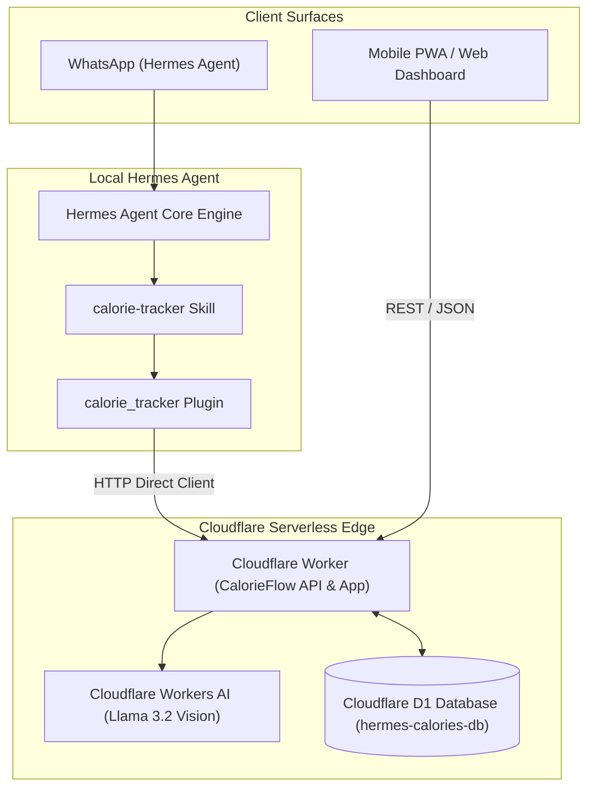

# Hermes Calorie & Macro Tracker (CalorieFlow)

An AI-powered nutrition, intermittent fasting, and body weight progression tracking ecosystem built for **Hermes Agent** and the web.


---

## 🌟 Highlights & Features

### 1. ⚡ Energy Balance & Macro Tracking
- **Apple Fitness-Inspired Radial Gauge**: Real-time visual progress ring tracking consumed vs. remaining daily calorie budget.
- **Macronutrient Split**: Dedicated progress bars and live ratio percentages for **Protein (g)**, **Carbohydrates (g)**, and **Fat (g)**.
- **Timeline & Categories**: Chronological meal feed tagged by category (*Breakfast*, *Lunch*, *Dinner*, *Snack*) with instant deletion and edit options.

### 2. 📸 Photo-to-Macros Visual AI Scanner
- **Cloudflare Workers AI**: Powered by `@cf/meta/llama-3.2-11b-vision-instruct` to visually inspect food photographs and estimate portion size, calories, and macronutrient breakdowns.
- **Dual Capture Pipeline**: Drag-and-drop or camera shutter (`capture="environment"`) on the web dashboard, plus direct image sending over **WhatsApp** via Hermes Agent.
- **Editable Pre-fill**: Detected values can be verified and fine-tuned before logging or saving as a one-tap preset.

### 3. ⏳ Intermittent Fasting Tracker
- **Live Circular Timer**: Real-time ticking stopwatch showing elapsed hours/minutes, countdown to target window, and percentage completion.
- **Protocol Presets**: 1-tap selectors for `14:10` (Gentle), `16:8` (Classic), `18:6` (Focused), `20:4` (Warrior), and `24h` OMAD.
- **Metabolic Milestones**: Visual tracking through 4 physiological phases:
  - **0–12h**: Blood sugar stabilization & glycogen depletion
  - **12–16h**: Lipolysis acceleration & ketosis entry
  - **16–18h**: Cellular autophagy & damaged protein recycling
  - **18h+**: Deep ketosis & elevated growth hormone
- **Smart Auto-Fasting**: Automatically calculates elapsed fasting time from the user's latest logged meal when no manual fast is active.

### 4. ⚖️ Weight Progression & Trend Curve
- **Interactive SVG Curve**: Dynamic spline visualization with gradient area fill and data points displaying date and weight.
- **Key Metrics**: Current Weight, Net Change (in emerald green), Goal Weight, and 7-day rolling average.
- **Weigh-in History**: Chronological log with notes (e.g. *Morning fasted*, *Post-run*) and delete capability.

### 5. 🔖 1-Tap Presets & Quick-Add
- Fast carousel of user staples (e.g., *Coffee*, *Protein Smoothie*, *Scrambled Eggs*) for instant single-click logging without repetitive typing.

### 6. 📱 Progressive Web App (PWA)
- Fully installable on iOS (Safari Add-to-Home-Screen instructions modal) and Android (Native install banner).
- Includes Web App Manifest (`manifest.json`), offline Service Worker (`sw.js`), and standalone dark cosmic theme.

### 7. 🤖 Hermes Agent & WhatsApp Integration
- 13 registered tools enabling conversational meal logging, photo macros, fasting status queries, and weight logging directly through WhatsApp:
  - `calorie_log_meal`
  - `calorie_get_summary`
  - `calorie_get_history`
  - `calorie_set_target`
  - `calorie_edit_meal`
  - `calorie_delete_meal`
  - `calorie_save_preset`
  - `calorie_list_presets`
  - `calorie_log_preset`
  - `calorie_log_weight`
  - `calorie_get_weight_history`
  - `calorie_get_fasting_status`
  - `calorie_start_fast` / `calorie_end_fast`
  - `calorie_analyze_food_photo`

---

## 🏛️ Architecture



---

## 📁 Repository Structure

```text
.
├── cloudflare_worker/          # Cloudflare Worker full-stack application
│   ├── src/
│   │   └── index.ts            # REST API, PWA UI, Workers AI, Fasting & Weight engines
│   ├── schema.sql              # D1 SQL database schema migrations
│   ├── wrangler.jsonc          # Cloudflare Worker configuration & D1/AI bindings
│   ├── package.json            # Dependencies & deployment scripts
│   └── tsconfig.json           # TypeScript configuration
├── hermes_plugin/              # Hermes Agent Python plugin
│   ├── __init__.py             # Tool registration & lifecycle hooks
│   ├── storage.py              # SQLite storage engine & migration routines
│   ├── tools.py                # Tool schemas, handlers & Cloudflare D1 HTTP client
│   ├── plugin.yaml             # Plugin metadata & tool manifests
│   └── dashboard/              # Local dashboard router bindings
├── skill/
│   └── SKILL.md                # Hermes Agent skill instructions & WhatsApp prompt guides
├── tests/
│   └── test_calorie_tracker.py # Complete pytest test suite (18 unit & contract tests)
├── .gitignore                  # Git ignore rules
└── README.md                   # Project documentation
```

---

## 🚀 Getting Started

### Prerequisites
- Node.js 18+ & npm
- [Cloudflare Wrangler CLI](https://developers.cloudflare.com/workers/wrangler/)
- Python 3.10+ (for Hermes Agent plugin testing)

### 1. Cloudflare Worker Deployment
```bash
cd cloudflare_worker
npm install

# Initialize D1 Database (if starting fresh)
npx wrangler d1 create hermes-calories-db
npx wrangler d1 execute hermes-calories-db --remote --file=schema.sql

# Deploy to Cloudflare Workers
npx wrangler deploy
```

### 2. Hermes Agent Plugin Setup
Symlink or copy the plugin into your Hermes Agent plugins directory:
```bash
ln -s "$(pwd)/hermes_plugin" "$HOME/.hermes/hermes-agent/plugins/calorie_tracker"
```

Configure your environment variable (optional, defaults to production worker):
```bash
export HERMES_CALORIE_WORKER_URL="https://hermes-calorie-tracker.<your-subdomain>.workers.dev"
```

### 3. Running Tests
```bash
pytest tests/test_calorie_tracker.py -v
```

---

## 📄 License
MIT License. Created by Dhruv Kumar Koshta & NousResearch.
